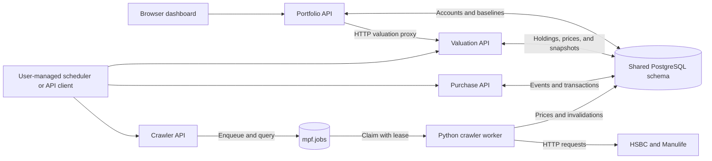

# MPF Tracker architecture

MPF Tracker consists of four application modules sharing a PostgreSQL database: crawler, portfolio, purchase, and valuation. The crawler has separate API and worker processes. Each module owns its source, dependencies, container build, and tests. Services communicate through database contracts and explicit HTTP calls; no service imports another service's application code.

See [README.md](./README.md) for installation, configuration, API usage, and test commands. This document describes the current implementation and its boundaries.

## Runtime topology



| Runtime | Implementation | Responsibility |
| --- | --- | --- |
| `mpf-crawler-api` | Node.js 22, TypeScript, Express, `pg`, Zod | Authenticate and validate requests; enqueue sync/backfill jobs; expose catalogue, prices, and job status |
| `mpf-crawler-worker` | Python 3.12, SQLAlchemy, psycopg, httpx | Claim jobs; fetch and parse provider data; persist prices; report execution results |
| `mpf-portfolio` | Node.js 22, TypeScript, Express, `pg`, Zod, decimal.js | Serve the dashboard; manage accounts, baselines, allocations, contribution plans, and reconciliations |
| `mpf-purchase` | Node.js 22, TypeScript, Express, `pg`, Zod, decimal.js | Estimate monthly purchase events and record confirmed transactions |
| `mpf-valuation` | Node.js 22, TypeScript, Express, `pg`, Zod, decimal.js | Calculate current/historical valuations; save and rebuild snapshots |
| `mpf-db` | PostgreSQL 17 | Store authoritative inputs, crawler queue, and derived snapshots |
| `mpf-migrate` | One-shot Python process | Create/update database roles and apply SQL schema files |

The four APIs listen on port `8000` inside their containers. Compose publishes them on host ports `8001`–`8004` by default. The worker exposes no HTTP server. An external scheduler can reach the APIs through published host ports or the shared external Docker network.

## Source organization

```text
crawler/
  api/src/
    index.ts                    Start the HTTP listener
    app.ts                      Middleware, health endpoint, error handling
    main.ts                     Crawler routes and request schemas
    libs/{auth,db,jobs}.ts       Authentication, SQL, idempotent enqueueing
    __tests__/unit/              Job contract tests
  conftest.py                   Shared Docker integration harness
  worker/src/
    app.py                      Environment configuration and process entry point
    main.py                     Polling loop, dispatch, heartbeat lifecycle
    libs/
      jobs.py                   Job claims, retries, completion, provider dispatch
      http_client.py            Provider HTTP transport and retry policy
      crawlers/{hsbc,manulife}.py
                                Provider fetch, parsing, and persistence
      pgsql/main.py             SQLAlchemy engine and transaction helpers
    __tests__/{unit,integration,live}/
portfolio/
  public/                       Dashboard HTML, CSS, and browser JavaScript
  src/
    index.ts, app.ts, main.ts    Listener, application wiring, router composition
    routes/                     Accounts, holdings, allocations, plans, reconciliation, fund switches
    libs/                       Authentication, SQL, schemas, decimal validation
    __tests__/unit/
purchase/src/
  index.ts, app.ts, main.ts      Listener, routes/schemas, purchase operations
  libs/                         Authentication, SQL, repository, calculation rules
  __tests__/unit/
valuation/src/
  index.ts, app.ts, main.ts      Listener, routes/schemas, valuation calculation
  libs/                         Authentication, SQL, repository, valuation rules
  __tests__/unit/
migrations/sql/                 Shared schema, constraints, indexes, and grants
scripts/migrate.py              Role setup and ordered SQL execution
mpf-codex-handoff/fixtures/      Saved provider responses for deterministic tests
```

TypeScript application wiring and domain operations stay within each service. Purchase keeps SQL in `main.ts`; valuation uses `main.ts` for holdings queries and `libs/repository.ts` for snapshots. Both keep arithmetic/date rules in `libs/rules.ts`. Portfolio routes perform their SQL operations using local database helpers. Provider adapters each own their fetch, parse, and persistence flow; they share HTTP retry and PostgreSQL helpers within the worker.

## Database contracts

[The migration SQL](./migrations/sql/001_init_schema.sql) defines the shared `mpf` schema. All four application database roles have read access to its tables. Write grants establish module ownership:

| Writer | Tables | Main relationships |
| --- | --- | --- |
| Crawler | `funds`, `fund_aliases`, `fund_scheme_memberships`, `fund_prices`, `jobs` | Prices are unique by fund and date; aliases and scheme memberships reference funds |
| Portfolio | `accounts`, `holdings_baselines`, `allocation_rules`, `contribution_plans`, `reconciliation_records`, `fund_switches`, `fund_switch_legs` | Account settings and dated holdings/allocation/plan inputs |
| Purchase | `contribution_events`, `purchase_transactions` | Events are unique by plan and month; transactions by event and fund |
| Valuation | `portfolio_snapshots`, `snapshot_fund_values` | Snapshots are unique by account and date; fund values by account, date, and fund |
| Shared contract | `snapshot_invalidation_requests` | Crawler, portfolio, and purchase can insert; valuation can process and update |

Funds use text identifiers; accounts, events, jobs, and other record IDs use UUIDs. Monetary amounts, units, weights, and prices use PostgreSQL `NUMERIC`; TypeScript calculations use decimal.js and generally return decimal strings.

The migration process creates or updates service login roles before applying sorted SQL files. Files are executed on every migration invocation, with no migration-version ledger, so they must be safe to reapply. Application containers depend on successful migration completion.

## Crawler execution

1. The crawler API validates a sync or backfill request and inserts a `queued` row into `mpf.jobs`. HTTP `202` returns its job identity rather than waiting for provider work.
2. A supplied `Idempotency-Key` identifies one request within the crawler service. Repeating an identical request returns the existing job; a different payload or job type with the same key returns `409`. Without a supplied key, the API creates a UUID key.
3. The worker claims the oldest eligible job using `FOR UPDATE SKIP LOCKED`, increments `attempts`, and sets `status = 'running'` with a lease. Expired running jobs can be reclaimed.
4. A background heartbeat renews the lease. Heartbeat and terminal updates include the attempt number so an obsolete worker claim cannot overwrite a newer claim's job status.
5. The worker dispatches the provider operation and persists results. Successful work becomes `succeeded`; reported per-fund failures produce `partial`.
6. An exception requeues the job with a delay of `30 × attempts` seconds while attempts remain. Three attempts exhaust the job and produce `failed`; expired leases at the attempt limit are also failed.

Lease ownership protects queue state. Provider persistence uses separate database transactions; a combined provider job is not one atomic transaction. A retry can revisit prices already written, with upserts and unique keys preventing duplicate fund-date rows.

Sync calculates its rolling date window in `Asia/Hong_Kong`, with a default seven-day window and a maximum of 28 days. Backfill uses explicit inclusive dates. Both use the same provider dispatch path.

HSBC fetches the `HB` scheme's all-funds CSV, splitting long ranges into 28-day chunks. Manulife loads the fund catalogue, fetches fund histories, and filters price points to the requested dates. Manulife records individual fetch/parse failures in the job result. Shared HTTP handling supplies timeouts, retries, and increasing retry delays.

## Portfolio and dashboard

The portfolio service serves `public/` with Express and protects `/v1/*` with API-key authentication. The browser stores the supplied key in session storage and sends it on API requests.

Portfolio owns account metadata and dated inputs. Allocation weights must total exactly `100`. Allocation and contribution-plan changes create versions with effective date ranges for a contribution stream. A reconciliation inserts an audit record and verified holdings baselines for the supplied funds, then requests snapshot invalidation in the same transaction.

Completed fund switches are append-only portfolio inputs: `mpf.fund_switches` stores the account, trade date, notes and client UUID; `mpf.fund_switch_legs` stores each fund, sold/bought side and actual units. A switch has one or more funds on each side, with no repeated or overlapping fund IDs. Migration `003_switch_legs.sql` preserves earlier one-to-one records and backfills their legs idempotently. Original one-to-one POST payloads remain accepted; reads return sales/purchases arrays. An account row lock serializes switch submissions. Availability checks exclude estimated contributions and validate later recorded sales when a switch is backdated. All legs and one snapshot invalidation commit in one transaction. A same-day existing baseline requires reconciliation instead because baselines describe end-of-day balances. Future contribution allocations are independent. The dashboard also proxies actual contribution confirmation to Purchase.

The holdings endpoint returns recorded baseline rows. The valuation service derives holdings as of a date. Dashboard valuation requests use portfolio proxy routes, which forward the API key to `VALUATION_API_URL`; portfolio does not duplicate the valuation calculations.

## Purchase processing

Purchase processing executes synchronously in an HTTP request and a database transaction. It selects active plans for the requested date, processes the month containing that date, and skips contributions whose expected day has not yet arrived. Days exceeding the month length are clamped to month end.

For each due plan, processing upserts an event keyed by plan and month, then resolves allocation rules effective at the month start. Missing allocations or weights that do not total `100` produce `FAILED_REVIEW`. Otherwise, each fund receives its percentage of the planned cash amount.

Estimation selects the first price row on or after the expected contribution date, up to 14 days later and no later than the processing date, and uses its bid price. Missing or nonpositive bids produce `WAITING_FOR_PRICE`. Available prices produce `ESTIMATED` transactions with units calculated from cash divided by price. Existing confirmed events are skipped, and estimated upserts preserve confirmed transactions.

Confirmation records supplied actual transaction values and marks the event `CONFIRMED`. Purchase changes insert snapshot invalidation requests. Purchase processing and confirmation use their own tables and execute directly; they do not enqueue `mpf.jobs` work.

## Valuation and snapshot lifecycle

For each account/fund, valuation selects the latest baseline on or before the requested date. It adds confirmed purchase units strictly after the baseline date and through the requested date, plus estimated units unless explicitly excluded. Confirmed switch legs after the baseline also change units. Funds introduced by switches enter without an artificial baseline (`baseline_date: null`), with subsequent purchases included from the first switch date. Other funds without a baseline remain excluded. A later or same-day baseline supersedes the earlier switch legs. Zero-unit positions have zero value and do not require a price.

The latest price row on or before the requested date supplies the bid price. Missing or nonpositive bids leave the fund unpriced. A price more than three calendar days old is stale. Calculation results distinguish price completeness from unit verification:

| Calculation status | Meaning |
| --- | --- |
| `COMPLETE` | All included funds have usable prices within the freshness threshold |
| `STALE` | All included funds are priced, with at least one stale price |
| `PARTIAL` | At least one included fund is unpriced; `total_value` is null and `priced_subtotal` contains the valued portion |

Fund details separately identify estimated units and baseline verification. Current valuation output assumes HKD and does not convert currencies.

`latest` and `as-of` calculate on demand without saving. `snapshot` applies pending invalidations, calculates the requested date, and upserts per-account snapshots and fund values. Replacing a snapshot increments its revision. Persisted partial or stale calculations also set the snapshot's `stale` flag.

Invalidation rows carry an optional account and date bounds. Valuation marks matching saved snapshots stale and records `processed_at` on the requests. An account-scoped operation currently selects requests for that exact account; global requests with a null account are consumed by an unscoped operation.

`rebuild` consumes invalidations and recalculates existing snapshot dates. With date bounds, it selects saved dates in that range; without bounds, it selects dates marked stale. It does not create a continuous calendar history. Invalidation and rebuilding run when these endpoints are called; there is no separate valuation worker.

## Deployment and scheduling

[Compose](./compose.yaml) starts PostgreSQL, waits for its readiness check, runs migration, then starts the APIs and crawler worker. PostgreSQL persists under `./data/postgres`. All services join `mpf-internal`; the APIs also join the external network named by `N8N_NETWORK`.

API `/health` endpoints return readiness based on a database query and require no key. The worker container health check also checks database connectivity; it does not prove that its polling loop or a provider endpoint is healthy.

Users must provide their own scheduler or make API calls manually. The daily sequence is price sync, purchase processing, then valuation snapshots. The caller must poll the asynchronous crawler job until `succeeded` before proceeding and handle `partial` or `failed` results. Purchase processing must finish before snapshot creation. See [the scheduling instructions](./README.md#schedule-requests-yourself) for request examples and recovery guidance. No scheduler or importable workflows are included in this repository.

## Test boundaries

- TypeScript unit suites live under each service's `src/__tests__/unit/` and run through Jest via `npm test`, which builds the service and provisions a temporary PostgreSQL instance for integration tests; `npm run test:unit` skips database integration tests.
- Python tests live under `crawler/worker/src/__tests__/`. Provider fixture tests mock `httpx.Client.request` using saved responses; some are located in `integration/` without the `integration` marker and belong to the offline suite.
- Tests marked `integration` use `crawler/conftest.py` to build the Compose stack in the `mpf-itest` project, with separate database roles, an isolated network, and a temporary database volume. They require Docker and use the default application host ports.
- Live provider smoke tests require `MPF_RUN_LIVE_TESTS=1`; they are excluded from routine offline testing. The stored Manulife `SHK122` history fixture supports deterministic parsing checks, while broader production backfill needs live validation.
- [GitHub Actions](./.github/workflows/test.yml) runs offline Python and TypeScript tests, then the Docker integration suite on pushes and pull requests.
