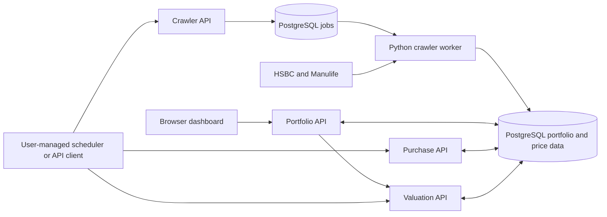

# MPF Portfolio Tracker

Track Hong Kong MPF accounts using HSBC and Manulife fund prices, dated holdings baselines, contribution estimates, and portfolio valuations. A browser dashboard provides account management, fund search, allocation and contribution-plan editing, reconciliation, and valuation history.

The repository contains four application modules: crawler, portfolio, purchase, and valuation. The crawler runs as a TypeScript API plus a Python worker; the other modules are TypeScript Express services. Each service owns its source and dependencies, and PostgreSQL schema permissions control which tables it can write. Users must schedule recurring operations themselves by calling the HTTP APIs; the stack does not include a scheduler. The portfolio service also proxies valuation requests for its dashboard.

## Services and data flow

| Compose service | Responsibility | Default host address |
| --- | --- | --- |
| `mpf-crawler-api` | Queue sync/backfill jobs; query jobs, funds, and prices | `http://localhost:8001` |
| `mpf-crawler-worker` | Fetch provider data and execute durable crawler jobs | No published port |
| `mpf-portfolio` | Dashboard, accounts, baselines, allocations, plans, reconciliation | `http://localhost:8002` |
| `mpf-purchase` | Estimate monthly purchases and confirm actual transactions | `http://localhost:8003` |
| `mpf-valuation` | Calculate valuations, save snapshots, rebuild history | `http://localhost:8004` |
| `mpf-db` | PostgreSQL 17; shared `mpf` schema | `localhost:5432` |
| `mpf-migrate` | Create/update database roles and apply SQL migrations | One-shot process |

All API containers listen on port `8000` internally. Clients on the shared Docker network use service names, for example `http://mpf-crawler-api:8000`.



Crawler jobs are asynchronous: `queued` → `running` → `succeeded`, `partial`, or `failed`. The worker uses leases and heartbeats, reclaims expired work, and allows up to three attempts. A `partial` result indicates per-fund failures; inspect the job's `result` and `error_message` before treating a crawl as complete. Purchase and valuation operations execute synchronously in their HTTP requests.

## Quick start

Requirements: Docker Engine with Docker Compose v2 and outbound access to the provider APIs.

1. Create your configuration if `.env` does not already exist:

   ```bash
   cp -n .env.example .env
   ```

   Edit `.env` and replace `API_KEY`, `POSTGRES_PASSWORD`, and all four service database passwords. The default ports and database host `mpf-db` are configured for Compose.

2. Create the external Docker network required by Compose. Use the name configured as `N8N_NETWORK` in `.env` (default: `automation`):

   ```bash
   docker network inspect automation >/dev/null 2>&1 || docker network create automation
   ```

   This network is required by the current Compose configuration. Attach any container-based scheduler to it if you want to call the APIs by service name.

3. Build and start the stack:

   ```bash
   docker compose up -d --build
   docker compose ps -a
   docker compose logs mpf-migrate
   ```

   `mpf-migrate` should exit with code `0`. APIs and the worker start after PostgreSQL is healthy and migration completes.

4. Open the dashboard at [http://localhost:8002/](http://localhost:8002/) and enter your configured `API_KEY`. The dashboard stores the key in browser session storage. Its static files are public; all `/v1/*` API routes require the `X-API-Key` header.

   Public readiness endpoints check database connectivity:

   ```bash
   curl --fail http://localhost:8001/health
   curl --fail http://localhost:8002/health
   curl --fail http://localhost:8003/health
   curl --fail http://localhost:8004/health
   ```

PostgreSQL data persists in `./data/postgres`. `docker compose down` stops and removes the stack's containers while retaining that directory. Changing `POSTGRES_PASSWORD` in `.env` does not update the password stored in an existing database; update the PostgreSQL role password to match before restarting migration. Exported shell variables also override `.env`; if test credentials were exported in your terminal, run `unset POSTGRES_PASSWORD` before `docker compose up -d` to use the configured password. Follow crawler execution with `docker compose logs -f mpf-crawler-worker`.

### Configuration

See [`.env.example`](./.env.example) for the complete Compose configuration.

| Settings | Purpose |
| --- | --- |
| `API_KEY` | Shared authentication key for all four APIs |
| `TZ` | Container timezone; default `Asia/Hong_Kong` |
| `API_BIND_ADDRESS`, `*_API_HOST_PORT` | API host interfaces and ports; defaults to `0.0.0.0` and `8001`–`8004` |
| `POSTGRES_BIND_ADDRESS`, `POSTGRES_HOST_PORT` | Published database interface and port; defaults to `0.0.0.0:5432` |
| `POSTGRES_DB`, `POSTGRES_USER`, `POSTGRES_PASSWORD` | Database bootstrap/migration credentials |
| `POSTGRES_HOST`, `POSTGRES_PORT` | Connection for host-run migration commands; Compose containers always use `mpf-db:5432` |
| `CRAWLER_DB_*`, `PORTFOLIO_DB_*`, `PURCHASE_DB_*`, `VALUATION_DB_*` | Separate database roles and passwords for each module |
| `WORKER_POLL_INTERVAL_SECONDS` | Idle job polling interval; default `2` |
| `WORKER_LEASE_SECONDS`, `WORKER_HEARTBEAT_SECONDS` | Worker lease duration and heartbeat interval; defaults to `90` and `15` |
| `N8N_NETWORK` | Existing external Docker network; default `automation` |

Compose connects migration and application containers to `mpf-db:5432` and maps their database names, users, and passwords from `.env`. Host-run tools use `127.0.0.1` and `POSTGRES_HOST_PORT`; exported host connection settings do not change container connections. It also sets the portfolio service's `VALUATION_API_URL` to `http://mpf-valuation:8000`.

## First-use workflow

1. Run a crawler sync and wait for a terminal job status. Funds must exist before they can be added to account holdings or allocation rules.
2. Create an account in the dashboard, then enter dated holdings baselines from your provider statement. Include a baseline for each fund you want valued, including a zero-unit baseline for a new fund before its first purchase.
3. Configure allocation percentages and a monthly contribution plan for each contribution stream. Allocations must total exactly `100`, and the plan and allocation stream names must match.
4. Run purchase processing for the required month. Review estimates in the dashboard's Contributions tab. When statement data is available, choose **Enter actual** for the event and enter the actual fund transactions. The submitted fund list replaces the estimates for that event.
5. Request an on-demand valuation or save a snapshot. Save snapshots to populate valuation history; rebuild affected saved dates after correcting historical inputs.

### API examples

These examples use the default host ports. Set `MPF_API_KEY` to the same value as `API_KEY` in `.env`:

```bash
export MPF_API_KEY='your-configured-api-key'

# Queue a seven-day sync for both providers.
curl --fail-with-body http://localhost:8001/v1/crawl/jobs/sync \
  -H "X-API-Key: $MPF_API_KEY" \
  -H 'Content-Type: application/json' \
  -d '{"provider":"all","rolling_days":7}'

# Replace JOB_ID with the returned job_id and poll until terminal.
curl --fail-with-body http://localhost:8001/v1/crawl/jobs/JOB_ID \
  -H "X-API-Key: $MPF_API_KEY"

# List crawled funds and their IDs.
curl --fail-with-body http://localhost:8001/v1/funds \
  -H "X-API-Key: $MPF_API_KEY"

# Process this month's due contributions using Hong Kong's current date.
curl --fail-with-body http://localhost:8003/v1/purchases/process \
  -H "X-API-Key: $MPF_API_KEY" \
  -H 'Content-Type: application/json' -d '{}'

# Save today's valuation snapshots.
curl --fail-with-body http://localhost:8004/v1/valuation/snapshot \
  -H "X-API-Key: $MPF_API_KEY" \
  -H 'Content-Type: application/json' -d '{}'
```

Crawler requests accept `provider: "all" | "hsbc" | "manulife"`. Sync accepts `rolling_days` from `1` to `28` (default `7`); backfill requires `from_date` and `to_date` in `YYYY-MM-DD` format. Both return HTTP `202` with the job ID. Supply `Idempotency-Key` to reuse a job for an identical request; reusing a key with a different request returns `409`. Omit the header to generate a new key and job.

## API reference

Every `/v1/*` route requires the `X-API-Key` header (a missing or wrong key returns `401 {"detail":"Invalid or missing API key"}`). Each service also exposes a public `GET /health` that needs no key and returns `200 {"service":..., "status":"ready", "database":"up"}` when PostgreSQL is reachable, or `503` with `status:"not_ready", database:"down"` otherwise. Account and job IDs are UUIDs; fund IDs come from the fund catalogue; dates use `YYYY-MM-DD`; decimal inputs accept strings or numbers (use strings to preserve precision). Validation failures return `400 {"detail":"Invalid request payload","issues":[...]}` from the Zod schema.

### Crawler — port 8001

#### `POST /v1/crawl/jobs/sync`
- **Purpose:** enqueue an asynchronous rolling-window price refresh job for the worker to execute.
- **Body parameters:** `provider` — `"all"` (default), `"hsbc"`, or `"manulife"`; `rolling_days` — integer `1`–`28` (default `7`).
- **Headers:** optional `Idempotency-Key` — reuse the existing job for an identical request; reusing a key with a different request returns `409 {"detail":"Idempotency-Key is already used for a different crawler request"}`. Omitting it generates a fresh key and job.
- **Returns:** `202 {"job_id": UUID, "service": "crawler", "job_type": "sync", "status": "queued"}`.

#### `POST /v1/crawl/jobs/backfill`
- **Purpose:** enqueue an asynchronous job that fetches an explicit date range of prices.
- **Body parameters:** `provider` (as above, default `"all"`); `from_date` and `to_date` — both required, `YYYY-MM-DD`. If `from_date > to_date`, returns `400 {"detail":"from_date must be <= to_date"}`.
- **Headers:** optional `Idempotency-Key` (same semantics as sync).
- **Returns:** `202 {"job_id": UUID, "service": "crawler", "job_type": "backfill", "status": "queued"}`.

#### `GET /v1/crawl/jobs/{job_id}`
- **Purpose:** read the current state of a queued crawler job.
- **Path parameter:** `job_id` (UUID).
- **Returns:** `200` with the job row `{job_id, service, job_type, status, idempotency_key, request, result, attempts, error_message, created_at, updated_at}`. `status` progresses `queued` → `running` → `succeeded`/`partial`/`failed`. Returns `404 {"detail":"Job not found"}` for an unknown ID.

#### `GET /v1/funds`
- **Purpose:** list crawled funds in the catalogue.
- **Query parameter:** `limit` — default `200`, maximum `1000` (out-of-range or non-numeric values fall back to the default).
- **Returns:** `200 {"count": N, "items": [{fund_id, provider, provider_fund_code, name, currency, last_seen_at}]}`, ordered by provider then fund ID.

#### `GET /v1/funds/{fund_id}/prices`
- **Purpose:** read historical price rows for one fund.
- **Path parameter:** `fund_id`.
- **Query parameters:** `from_date` and `to_date` (optional `YYYY-MM-DD` bounds); `limit` — default `500`, maximum `5000`.
- **Returns:** `200 {"fund_id": ..., "count": N, "items": [{fund_id, price_date, bid, offer, source, fetched_at, updated_at}]}`, newest price date first.

### Portfolio — port 8002

#### `GET /v1/funds`
- **Purpose:** resolve fund IDs for display, or search the fund catalogue for the dashboard picker.
- **Query parameters:** `ids` — comma-separated fund IDs (takes precedence over `search`, capped at 100); `search` — name/ID/provider-code/alias fragment, minimum two characters (shorter or empty returns `{"count":0,"items":[]}`).
- **Returns:** `200 {"count": N, "items": [{fund_id, provider, provider_fund_code, name, aliases: [...]}]}`. Search results are ranked (name match first, then alias) and limited to 20.

#### `GET /v1/accounts`
- **Purpose:** list all MPF accounts, newest first.
- **Parameters:** none.
- **Returns:** `200` array of `{account_id, provider, scheme, display_label, currency, active}`.

#### `POST /v1/accounts`
- **Purpose:** create a new account.
- **Body parameters:** `provider` (1–64 chars), `scheme` (1–64 chars), `display_label` (1–255 chars), `currency` — 3-letter code (default `HKD`, upper-cased).
- **Returns:** `201` with the created `{account_id, provider, scheme, display_label, currency, active}`.

#### `GET /v1/accounts/{account_id}`
- **Purpose:** read one account.
- **Path parameter:** `account_id` (UUID).
- **Returns:** `200 {account_id, provider, scheme, display_label, currency, active}`, or `404 {"detail":"Account not found"}`.

#### `PUT /v1/accounts/{account_id}`
- **Purpose:** update mutable account fields.
- **Body parameters:** one or more of `display_label` (1–255), `currency` (3-letter), `active` (boolean). An empty body returns `400 {"detail":"At least one field must be supplied"}`.
- **Returns:** `200` with the updated account row.

#### `GET /v1/accounts/{account_id}/holdings`
- **Purpose:** list every recorded holdings baseline for an account, newest first.
- **Returns:** `200 {account_id, items: [{baseline_id, fund_id, effective_date, units, source, verification_status, created_at}]}`.

#### `POST /v1/accounts/{account_id}/baselines`
- **Purpose:** record a dated set of fund unit balances and invalidate derived snapshots from that date.
- **Body parameters:** `effective_date`; `source` (1–64 chars); `verification_status` — `"VERIFIED"` or `"ESTIMATED"`; `holdings[]` (at least one) with `fund_id` and `units`. Unknown fund IDs return `400` with `Fund not found: <id>`.
- **Returns:** `200 {account_id, inserted_baselines: N}`.

#### `GET /v1/accounts/{account_id}/allocation-rules`
- **Purpose:** list current and historical allocation rules for an account, newest first.
- **Returns:** `200 {account_id, items: [{rule_id, fund_id, contribution_stream, effective_from, effective_to, weight, created_at}]}`.

#### `PUT /v1/accounts/{account_id}/allocation-rules`
- **Purpose:** version the allocation for one contribution stream — retiring the prior version and inserting a new one.
- **Body parameters:** `effective_from`; optional `effective_to`; `contribution_stream` (1–32 chars, lower-cased); `allocations[]` (at least one) with `fund_id` and `weight`. Weights must be `>= 0` and sum to exactly `100` (otherwise `400 {"detail":"allocations[].weight must be >= 0"}` or `{"detail":"allocation weights must sum to exactly 100"}`).
- **Returns:** `200 {account_id, contribution_stream, effective_from, allocation_count: N}`.

#### `GET /v1/accounts/{account_id}/contribution-plans`
- **Purpose:** list current and historical contribution plans, newest first.
- **Returns:** `200 {account_id, items: [{plan_id, contribution_stream, amount, expected_day, effective_from, effective_to, active, created_at}]}`.

#### `PUT /v1/accounts/{account_id}/contribution-plans`
- **Purpose:** replace the active plan for one contribution stream (prior version is deactivated and closed).
- **Body parameters:** `contribution_stream` (1–32, lower-cased); `amount` (must be `> 0`, else `400 {"detail":"amount must be > 0"}`); `expected_day` (integer `1`–`31`); `effective_from`; optional `effective_to`.
- **Returns:** `200 {plan_id, account_id, contribution_stream}`.

#### `GET /v1/accounts/{account_id}/contribution-history`
- **Purpose:** list processed contribution events with their estimated or confirmed transactions.
- **Returns:** `200 {account_id, count: N, items: [{event_id, period, expected_date, amount, status, created_at, contribution_stream, transactions: [{fund_id, trade_date, cash_amount, unit_price, units_delta, status}]}]}`, newest first.

#### `GET /v1/accounts/{account_id}/reconciliations`
- **Purpose:** list reconciliation records with the verified balances recorded on each date.
- **Returns:** `200 {account_id, items: [{reconciliation_id, effective_date, notes, created_at, holdings: [{fund_id, units}]}]}`, newest first.

#### `POST /v1/accounts/{account_id}/reconciliations`
- **Purpose:** append an authoritative eMPF reconciliation, create `VERIFIED` holding baselines (source `reconciliation`), and invalidate derived snapshots.
- **Body parameters:** `effective_date`; optional `notes`; `holdings[]` (at least one) with `fund_id` and `units`.
- **Returns:** `200 {account_id, effective_date, inserted_baselines: N}`.

#### `GET /v1/accounts/{account_id}/switches`
- **Purpose:** list completed fund switches, newest trade date first.
- **Returns:** `200 {account_id, items: [{switch_id, trade_date, sales: [{fund_id, units}], purchases: [{fund_id, units}], notes, created_at}]}`.

#### `POST /v1/accounts/{account_id}/switches`
- **Purpose:** record an actual, completed switch selling one or more funds and buying one or more funds in the same account. Use the dashboard's **Switch funds** tab, or submit the actual units from your provider statement.
- **Body:** `switch_id` (client-generated UUID), `trade_date` (`YYYY-MM-DD`), `sales` and `purchases` (each 1–100 entries with `fund_id` and positive decimal-string `units`, up to 14 integer and 10 fractional digits), optional `notes` (up to 2000 characters).
- **Returns:** `201 {switch_id, created: true}`. Repeating the same ID and values (regardless of fund-row order) returns `200 {switch_id, created: false}`; different values with that ID return `409`.
- All funds must match the account's provider and currency; select funds eligible for its scheme. Recorded baselines, confirmed contributions, and earlier switches determine available units. Estimated contributions cannot fund a switch. Insufficient units (including at a later recorded switch) return `400` and roll back the operation.
- The original one-to-one request fields (`from_fund_id`, `to_fund_id`, `units_sold`, `units_bought`) are still accepted for existing clients; responses use the grouped `sales`/`purchases` format. Migration `003_switch_legs.sql` preserves earlier switch records and converts them into legs.
- Baselines represent end-of-day balances. If any selected fund already has a baseline on the trade date, returns `409`; use reconciliation for those end-of-day balances instead.
- Switches preserve an append-only history and invalidate saved valuations from the trade date. They do not create contributions or change future contribution allocations. Record all selling and buying funds in one operation with one trade date. Each fund may appear once across both lists; units across different funds are not summed or required to match. Every leg saves atomically, with one invalidation. Correct later actual balances through reconciliation.

#### `GET /v1/valuation/latest`
- **Purpose:** proxy the on-demand valuation from the Valuation API for the dashboard.
- **Query parameter:** `account_id` (required UUID; missing returns `400 {"detail":"account_id query parameter is required"}`).
- **Returns:** the Valuation API's `latest` payload (status and body are passed through).

#### `GET /v1/valuation/history`
- **Purpose:** proxy saved valuation snapshots from the Valuation API.
- **Query parameters:** `account_id` (required UUID); optional `from_date`, `to_date`.
- **Returns:** the Valuation API's `history` payload (passed through).

### Purchase — port 8003

#### `POST /v1/purchases/process`
- **Purpose:** synchronously create contribution events for the month containing `as_of_date`, estimate purchases for due plans, and enqueue snapshot invalidations.
- **Body parameters:** optional `as_of_date` (`YYYY-MM-DD`, default Hong Kong today); optional `account_id` (UUID, restricts to one account).
- **Returns:** `200` summary `{as_of_date, processed_events, estimated_events, waiting_events, failed_events, inserted_transactions, updated_transactions, waiting_details: [{event_id, reason}]}`. Event statuses become `ESTIMATED`, `WAITING_FOR_PRICE` (missing/nonpositive price), or `FAILED_REVIEW` (missing/invalid allocation); already-`CONFIRMED` events are skipped.

#### `GET /v1/purchases/events`
- **Purpose:** list contribution events, newest expected date first.
- **Query parameter:** `limit` — default `500`, clamped to `1`–`5000`.
- **Returns:** `200 {count: N, items: [{event_id, plan_id, period, expected_date, amount, status, created_at, updated_at}]}`.

#### `GET /v1/purchases/transactions`
- **Purpose:** list purchase transactions, newest trade date first.
- **Query parameter:** `limit` — default `500`, clamped to `1`–`5000`.
- **Returns:** `200 {count: N, items: [{transaction_id, event_id, fund_id, trade_date, cash_amount, unit_price, units_delta, status, estimation_policy, created_at, updated_at}]}`.

#### `POST /v1/purchases/events/{event_id}/confirm`
- **Purpose:** confirm the complete transaction set for one contribution event, replacing estimates and marking the event `CONFIRMED`. Funds omitted from the payload are removed; all supplied transactions are stored as `CONFIRMED`.
- **Path parameter:** `event_id` (UUID; unknown returns `404 {"detail":"Contribution event not found"}`).
- **Body parameters:** `trade_date` (`YYYY-MM-DD`, default trade date); `transactions[]` (at least one) with `fund_id`, `cash_amount`, `unit_price`, `units_delta`, and optional per-transaction `trade_date`. `fund_id` values must be unique (duplicates return `400 {"detail":"transactions[].fund_id must be unique"}`).
- **Returns:** `200 {event_id, confirmed_transactions: N}`. Snapshots are invalidated from the earliest previous or supplied trade date onward.

### Valuation — port 8004

#### `POST /v1/valuation/snapshot`
- **Purpose:** apply pending invalidations, calculate the valuation for a date, and persist per-account snapshots (incrementing revisions on replacement).
- **Body parameters:** optional `as_of_date` (`YYYY-MM-DD`, default Hong Kong today); optional `account_id` (UUID).
- **Returns:** `200 {requested_as_of, saved_accounts: N, calculation_status, unpriced_fund_count}`.

#### `POST /v1/valuation/rebuild`
- **Purpose:** apply pending invalidations and recalculate existing saved snapshot dates (does not fill missing calendar dates).
- **Body parameters:** optional `from_date` and `to_date` (`YYYY-MM-DD`); optional `account_id`. With neither date, rebuilds stale snapshots; with a date range, rebuilds saved dates within it.
- **Returns:** `200 {rebuilt_dates: [...], rebuilt_count: N, invalidations_applied: N}`.

#### `GET /v1/valuation/latest`
- **Purpose:** calculate the valuation for Hong Kong today without saving.
- **Query parameters:** optional `account_id` (UUID); `include_estimated` — defaults to `true`, set `false` to exclude estimated units.
- **Returns:** `200` `CalculationResult` `{requested_as_of, calculated_at, currency: "HKD", calculation_status: "COMPLETE"|"PARTIAL"|"STALE", total_value: string|null, priced_subtotal, unpriced_fund_count, accounts: [{account_id, currency, calculation_status, total_value, priced_subtotal, unpriced_fund_count, funds: [...]}]}`. `total_value` is `null` when any fund is unpriced (`PARTIAL`).

#### `GET /v1/valuation/as-of`
- **Purpose:** calculate the valuation for a specific date without saving.
- **Query parameters:** `date` — required `YYYY-MM-DD` (missing/invalid returns `400 {"detail":"date query parameter must be YYYY-MM-DD"}`); optional `account_id`; `include_estimated` (default `true`).
- **Returns:** same `CalculationResult` shape as `latest`.

#### `GET /v1/valuation/history`
- **Purpose:** read saved valuation snapshots.
- **Query parameters:** optional `account_id`, `from_date`, `to_date`.
- **Returns:** `200 {count: N, items: [...]}` of persisted snapshot records.

## Calculation behavior and limits

- **Holdings:** valuation starts from the latest baseline per account and fund on or before the requested date, then adds purchase transactions strictly after that baseline and through the requested date. Confirmed switch units are also added or subtracted after that baseline. A switch into a new fund establishes its holdings without requiring a zero baseline; subsequent contributions are included from the first switch date. Other funds without a baseline are excluded. Zero-unit positions have zero value even without a price.
- **Purchase estimates:** processing handles the month containing `as_of_date`; repeat with dates in earlier months to process missed periods. Expected days beyond a month's length are clamped to month end. Estimates select the first price row on or after the expected date, within 14 days and no later than `as_of_date`, and use its bid price. A missing or nonpositive bid prevents estimation. Missing prices produce `WAITING_FOR_PRICE`; missing or invalid allocations produce `FAILED_REVIEW`. Confirmed events are skipped on subsequent processing.
- **Valuation prices:** the latest price row on or before the requested date supplies its bid price. Missing or nonpositive bids leave the holding unpriced. Prices more than three calendar days old are marked `STALE`.
- **Completeness:** an unpriced fund makes the result `PARTIAL`, with `total_value: null` and a separate `priced_subtotal`. Estimated units are included by default and identified in fund details. `COMPLETE` describes price completeness and freshness; it does not mean all units are verified.
- **Snapshots:** live valuation queries calculate without saving. Snapshot writes persist per-account results and increment revisions on replacement. Changes to prices, baselines, purchases, or fund switches enqueue invalidation requests; snapshot/rebuild operations consume them. Rebuild recalculates existing snapshot dates and does not fill every missing calendar date.
- **Currency:** current valuation results use HKD and perform no foreign-exchange conversion, even though account records accept other currency codes.
- **Providers:** HSBC fetches the `HB` scheme and splits long ranges into 28-day requests. Manulife fetches each fund's history and filters it to the requested range. A real `SHK122` history response is stored as a fixture; broader Manulife production backfill still needs live validation.

## Repository layout

```text
.
├── compose.yaml
├── .env.example
├── crawler/
│   ├── api/src/                 # Express API, durable job enqueueing, unit tests
│   ├── conftest.py              # Docker integration harness
│   └── worker/src/              # Python worker, provider adapters, persistence
│       └── __tests__/           # Unit, fixture/provider integration, live tests
├── portfolio/
│   ├── public/                  # Browser dashboard: HTML, CSS, JavaScript
│   └── src/                     # Express routes, account rules, unit tests
├── purchase/src/                # Purchase estimation, confirmation, Jest tests
├── valuation/src/               # Valuation, snapshots, unit tests
├── migrations/sql/              # Shared schema and database grants
├── scripts/migrate.py           # Role setup and SQL migration runner
├── mpf-codex-handoff/            # Implementation notes and saved provider fixtures
└── .github/workflows/test.yml   # Python, TypeScript, and Docker integration CI
```

TypeScript services use `index.ts` to start the server, `app.ts` to wire middleware/routes, and service-local `main.ts` and `libs/` for operations and integrations. The worker starts with `app.py` and runs its job loop in `main.py`. No module imports another module's application source.

### Database write ownership

All service roles can read shared tables. Writes are restricted by [the SQL migrations](./migrations/sql/):

| Owner | Tables in schema `mpf` |
| --- | --- |
| Crawler | `funds`, `fund_aliases`, `fund_scheme_memberships`, `fund_prices`, `jobs` |
| Portfolio | `accounts`, `holdings_baselines`, `allocation_rules`, `contribution_plans`, `reconciliation_records`, `fund_switches` and `fund_switch_legs` (insert only) |
| Purchase | `contribution_events`, `purchase_transactions` |
| Valuation | `portfolio_snapshots`, `snapshot_fund_values` |
| Shared invalidation contract | Crawler/portfolio/purchase insert `snapshot_invalidation_requests`; valuation processes them |

The migration runner creates or updates service login roles and executes sorted SQL files from `migrations/sql/`. It reruns the files on invocation; migrations must remain safe to reapply.

## Schedule requests yourself

The stack does not run recurring API requests automatically. Configure your own scheduler (for example, cron, a systemd timer, or an external automation service) to send the requests below with your configured `X-API-Key`. You can also run them manually.

| Order | Request | Purpose |
| --- | --- | --- |
| 1 | `POST http://localhost:8001/v1/crawl/jobs/sync` | Refresh both providers using a seven-day rolling window |
| 2 | `POST http://localhost:8003/v1/purchases/process` | Process due contributions and retry estimates waiting for prices |
| 3 | `POST http://localhost:8004/v1/valuation/snapshot` | Save valuations for dashboard history |

Run this sequence daily in `Asia/Hong_Kong`, for example starting at 07:00. Wait for the crawler job to succeed before processing purchases, then wait for purchase processing to finish before saving snapshots. Fixed time gaps alone do not guarantee that the previous operation has completed.

The examples use the default host ports. Export `API_KEY` in the shell or scheduler environment before running them:

```bash
# 1. Queue a price refresh and record the returned job_id.
curl --fail-with-body -sS http://localhost:8001/v1/crawl/jobs/sync \
  -H "X-API-Key: $API_KEY" \
  -H 'Content-Type: application/json' \
  -d '{"provider":"all","rolling_days":7}'

# Poll using the returned job_id (replace the placeholder).
curl --fail-with-body -sS http://localhost:8001/v1/crawl/jobs/JOB_ID \
  -H "X-API-Key: $API_KEY"

# 2. After the crawler succeeds, process purchases.
curl --fail-with-body -sS http://localhost:8003/v1/purchases/process \
  -H "X-API-Key: $API_KEY" \
  -H 'Content-Type: application/json' \
  -d '{}'

# 3. After purchase processing finishes, save today's snapshots.
curl --fail-with-body -sS http://localhost:8004/v1/valuation/snapshot \
  -H "X-API-Key: $API_KEY" \
  -H 'Content-Type: application/json' \
  -d '{}'
```

Crawler submission returns HTTP `202`, which means the job was queued. Poll its status periodically (for example, every 30 seconds) while it is `queued` or `running`, with a timeout configured in your scheduler. Continue only on `succeeded`; inspect `result` and `error_message` for `partial` or `failed` jobs and resolve or retry them. Inspect purchase results for `WAITING_FOR_PRICE` or `FAILED_REVIEW`, and snapshot results for incomplete valuations.

Empty purchase and snapshot bodies use today's date in Hong Kong and include all applicable accounts. Supply `as_of_date` (`YYYY-MM-DD`) to process an earlier month or save a historical snapshot. Purchase processing handles only the month containing that date, so process missed months explicitly. Use the backfill and rebuild endpoints in the API reference when recovering older prices or recalculating existing history.

## Migrating the database between environments

Use this runbook to move data from a dev/test instance to another host, for example `10.7.7.79` to `10.7.7.78`. Copy `pg_dump` output rather than the `./data/postgres` directory: the cluster directory is sensitive to the PostgreSQL major version and locale, and grants should always come from the target host's own `.env`.

The migration SQL is idempotent (`CREATE TABLE IF NOT EXISTS`, `CREATE INDEX IF NOT EXISTS`) and `scripts/migrate.py` creates or alters the four service roles from environment variables on every run, so restoring a dump into an empty database and then running `mpf-migrate` reproduces roles and grants. All primary keys use `gen_random_uuid()` defaults, so there are no sequences to reset after a restore.

### 1. Dump from the source host

`mpf.jobs` is queue state and should not cross environments; `mpf-migrate` recreates it on the target. `--no-owner --no-privileges` prevents the dump from referencing role names that may not exist on the target.

```bash
cd ~/Workspaces/MPF-Tracker
U=$(grep -m1 '^POSTGRES_USER=' .env | cut -d= -f2-)
D=$(grep -m1 '^POSTGRES_DB=' .env | cut -d= -f2-)
docker exec mpf-tracker-mpf-db-1 pg_dump -U "$U" -d "$D" -Fc \
  --no-owner --no-privileges -T mpf.jobs -f /tmp/mpf-dev.dump
docker cp mpf-tracker-mpf-db-1:/tmp/mpf-dev.dump ./mpf-dev.dump
scp ./mpf-dev.dump <target-host>:~/mpf-tracker/
```

### 2. Restore on the target host

Restore into an **empty** database. If the target already contains MPF tables from earlier testing, drop and recreate the database first; restoring on top of existing rows collides on the unique keys.

```bash
cd ~/mpf-tracker && git pull
docker compose up -d mpf-db
docker cp ./mpf-dev.dump mpf-tracker-mpf-db-1:/tmp/
PU=$(grep -m1 '^POSTGRES_USER=' .env | cut -d= -f2-)
PD=$(grep -m1 '^POSTGRES_DB=' .env | cut -d= -f2-)
docker exec mpf-tracker-mpf-db-1 pg_restore -U "$PU" -d "$PD" --no-owner --no-privileges /tmp/mpf-dev.dump
docker compose up -d   # runs mpf-migrate (roles and grants), then the APIs and worker
```

### 3. Verify

```bash
docker exec mpf-tracker-mpf-db-1 psql -U "$PU" -d "$PD" -Atc \
  "SELECT 'accounts',count(*) FROM mpf.accounts UNION ALL SELECT 'prices',count(*) FROM mpf.fund_prices UNION ALL SELECT 'snapshots',count(*) FROM mpf.portfolio_snapshots"
curl -fsS http://<target-host>:8002/health
```

Compare the counts against the source host before cutover.

### Environment file on the target

- New `POSTGRES_PASSWORD` and the four `*_DB_PASSWORD` values are fine; `mpf-migrate` creates the roles and re-grants permissions.
- Keep `POSTGRES_DB` matching the database name used at restore time.
- Set a target `API_KEY` distinct from the development value.
- The external network named by `N8N_NETWORK` must exist on the target; Compose requires it, and that is where a container-based scheduler attaches.

### After cutover

Stop the source worker (`docker compose stop mpf-crawler-worker`) so two workers do not crawl the providers independently, and repoint the scheduler at the target host. Keep the source stack running until the target has completed one full sync → purchase → snapshot cycle, so it remains available as a rollback.

## Development and testing

Local development uses Node.js 22, npm, and Python 3.12, matching the container and CI runtimes. Install dependencies from the repository root:

```bash
python3 -m venv .venv
.venv/bin/pip install -r requirements.txt -r crawler/worker/requirements.txt
for service in crawler/api portfolio purchase valuation; do
  (cd "$service" && npm ci)
done
```

Run tests without Docker or live provider requests:

```bash
.venv/bin/python -m pytest -q -m 'not integration and not live'
for service in crawler/api portfolio purchase valuation; do
  (cd "$service" && npm test)
done
```

Each TypeScript service also supports `npm run build` and `npm start`. For a host-run API, provide `API_KEY`, `PORT`, and its service database settings using `DB_HOST=127.0.0.1` and the published database port. A host-run portfolio service also needs `VALUATION_API_URL=http://localhost:8004`. The applications do not automatically load `.env`.

Python provider tests use saved responses under `mpf-codex-handoff/fixtures` and mock `httpx.Client.request`. The marked integration tests use the Docker harness in `crawler/conftest.py`, a separate Compose project (`mpf-itest`), and a temporary database volume:

```bash
.venv/bin/python -m pytest -q -m integration
```

Integration tests require Docker and access to build images; the harness skips them if Docker is unavailable. The test stack uses temporary host ports, so it can run alongside a development stack.

Live crawler smoke tests call real provider endpoints:

```bash
.venv/bin/python -m pytest -q -m live

# Or run one provider:
.venv/bin/python -m pytest -q \
  crawler/worker/src/__tests__/live/test_hsbc_live.py
```

Use `test_manulife_live.py` for the corresponding Manulife check. [GitHub Actions](./.github/workflows/test.yml) runs suites one at a time on pushes and pull requests: Python crawler worker (including integration and live tests), crawler API, portfolio, purchase, then valuation. Each suite must pass before the next starts. CI checks Docker availability first, and each TypeScript service's `npm test` shell script creates, migrates, and removes its own temporary PostgreSQL database.

CI prints per-file coverage for the Python worker and for TypeScript modules
loaded by each service's unit tests. Crawler API, portfolio, purchase, and valuation use Jest coverage across all source modules. Python coverage includes integration and
live tests. Node's built-in coverage report omits modules that the unit tests
never load; requests made to running TypeScript services by the Docker
integration tests are not included in those TypeScript percentages.

To run both providers' live endpoint checks on demand, open the [Live Provider Endpoints workflow](./.github/workflows/live-endpoints.yml) in GitHub Actions and choose **Run workflow**. It has no schedule. GitHub shows this manual trigger after the workflow file reaches the default branch.

Crawler API, portfolio, purchase, and valuation use Jest with real PostgreSQL integration tests.
Run `npm ci` and `npm test` inside any of those service folders (`crawler/api`, `portfolio`, `purchase`, or `valuation`), for example:

```bash
cd portfolio
npm ci
npm test
```

The script starts a temporary PostgreSQL 17 container on an available local port, creates the
service roles, applies the project SQL migrations, and removes the container after the run,
including when tests fail. Docker must be installed and running; no local Python setup is needed.

`npm run test:unit` runs only unit and HTTP tests without PostgreSQL.
`npm run test:integration` provisions the same temporary database and runs only database tests.
`npm run test:all` is an alias for `npm test`.

To reuse an existing isolated database, set `TEST_DATABASE_URL` and the service's password variable:
`CRAWLER_DB_PASSWORD`, `PORTFOLIO_DB_PASSWORD`, `PURCHASE_DB_PASSWORD`, or `VALUATION_DB_PASSWORD`.
That database must already have migrations applied and the corresponding `mpf_crawler`, `mpf_portfolio`,
`mpf_purchase`, or `mpf_valuation` role available;
the script leaves it running. Tests insert committed dummy rows, call the real purchase functions,
and verify saved results through a separate connection. Each test deletes its own fixtures afterward.
CI runs the same `npm test` commands sequentially, with a separate temporary database for each service.

Purchase operations own one transaction and execute SQL directly;
estimation and confirmation batch their writes rather than issuing queries inside fund loops.
