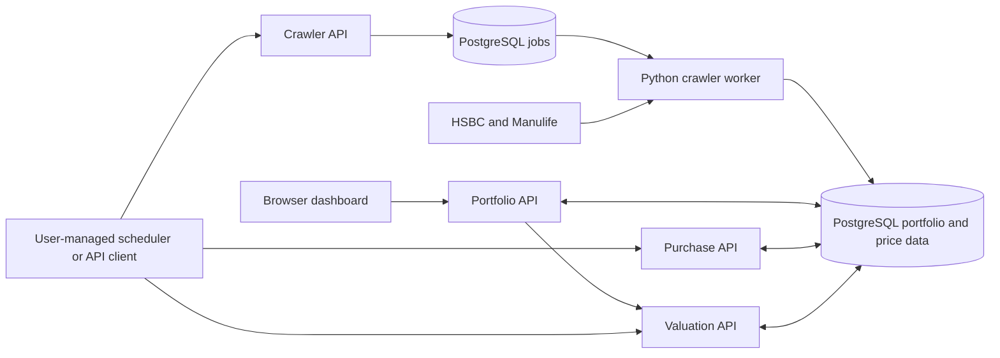

# MPF Portfolio Tracker

Track Hong Kong MPF accounts using HSBC and Manulife fund prices, dated holdings baselines, contribution estimates, and portfolio valuations. A browser dashboard provides account management, fund search, allocation and contribution-plan editing, reconciliation, and valuation history.

The repository contains four application modules: crawler, portfolio, purchase, and valuation. The crawler runs as a TypeScript API plus a Python worker; the other modules are TypeScript Express services. Each service owns its source and dependencies, and PostgreSQL schema permissions control which tables it can write. Users must schedule recurring operations themselves by calling the HTTP APIs; the stack does not include a scheduler. The portfolio service also proxies valuation requests for its dashboard.

## Services and data flow

| Compose service | Responsibility | Default host address |
| --- | --- | --- |
| `mpf-crawler-api` | Queue sync/backfill jobs; query jobs, funds, and prices | `http://localhost:8001` |
| `mpf-crawler-worker` | Fetch provider data and execute durable crawler jobs | No published port |
| `mpf-portfolio` | Dashboard, accounts, baselines, allocations, plans, reconciliation | `http://localhost:8002` |
| `mpf-purchase` | Estimate monthly purchases and confirm actual transactions | `http://localhost:8003` |
| `mpf-valuation` | Calculate valuations, save snapshots, rebuild history | `http://localhost:8004` |
| `mpf-db` | PostgreSQL 17; shared `mpf` schema | `localhost:5432` |
| `mpf-migrate` | Create/update database roles and apply SQL migrations | One-shot process |

All API containers listen on port `8000` internally. Clients on the shared Docker network use service names, for example `http://mpf-crawler-api:8000`.



Crawler jobs are asynchronous: `queued` → `running` → `succeeded`, `partial`, or `failed`. The worker uses leases and heartbeats, reclaims expired work, and allows up to three attempts. A `partial` result indicates per-fund failures; inspect the job's `result` and `error_message` before treating a crawl as complete. Purchase and valuation operations execute synchronously in their HTTP requests.

## Quick start

Requirements: Docker Engine with Docker Compose v2 and outbound access to the provider APIs.

1. Create your configuration if `.env` does not already exist:

   ```bash
   cp -n .env.example .env
   ```

   Edit `.env` and replace `API_KEY`, `POSTGRES_PASSWORD`, and all four service database passwords. The default ports and database host `mpf-db` are configured for Compose.

2. Create the external Docker network required by Compose. Use the name configured as `N8N_NETWORK` in `.env` (default: `automation`):

   ```bash
   docker network inspect automation >/dev/null 2>&1 || docker network create automation
   ```

   This network is required by the current Compose configuration. Attach any container-based scheduler to it if you want to call the APIs by service name.

3. Build and start the stack:

   ```bash
   docker compose up -d --build
   docker compose ps -a
   docker compose logs mpf-migrate
   ```

   `mpf-migrate` should exit with code `0`. APIs and the worker start after PostgreSQL is healthy and migration completes.

4. Open the dashboard at [http://localhost:8002/](http://localhost:8002/) and enter your configured `API_KEY`. The dashboard stores the key in browser session storage. Its static files are public; all `/v1/*` API routes require the `X-API-Key` header.

   Public readiness endpoints check database connectivity:

   ```bash
   curl --fail http://localhost:8001/health
   curl --fail http://localhost:8002/health
   curl --fail http://localhost:8003/health
   curl --fail http://localhost:8004/health
   ```

PostgreSQL data persists in `./data/postgres`. `docker compose down` stops and removes the stack's containers while retaining that directory. Follow crawler execution with `docker compose logs -f mpf-crawler-worker`.

### Configuration

See [`.env.example`](./.env.example) for the complete Compose configuration.

| Settings | Purpose |
| --- | --- |
| `API_KEY` | Shared authentication key for all four APIs |
| `TZ` | Container timezone; default `Asia/Hong_Kong` |
| `API_BIND_ADDRESS`, `*_API_HOST_PORT` | API host interfaces and ports; defaults to `0.0.0.0` and `8001`–`8004` |
| `POSTGRES_BIND_ADDRESS`, `POSTGRES_HOST_PORT` | Published database interface and port; defaults to `0.0.0.0:5432` |
| `POSTGRES_DB`, `POSTGRES_USER`, `POSTGRES_PASSWORD` | Database bootstrap/migration credentials |
| `POSTGRES_HOST`, `POSTGRES_PORT` | Database address inside Compose; defaults to `mpf-db:5432` |
| `CRAWLER_DB_*`, `PORTFOLIO_DB_*`, `PURCHASE_DB_*`, `VALUATION_DB_*` | Separate database roles and passwords for each module |
| `WORKER_POLL_INTERVAL_SECONDS` | Idle job polling interval; default `2` |
| `WORKER_LEASE_SECONDS`, `WORKER_HEARTBEAT_SECONDS` | Worker lease duration and heartbeat interval; defaults to `90` and `15` |
| `N8N_NETWORK` | Existing external Docker network; default `automation` |

Compose maps the database settings into each application's `DB_HOST`, `DB_PORT`, `DB_NAME`, `DB_USER`, and `DB_PASSWORD`. It also sets the portfolio service's `VALUATION_API_URL` to `http://mpf-valuation:8000`.

## First-use workflow

1. Run a crawler sync and wait for a terminal job status. Funds must exist before they can be added to account holdings or allocation rules.
2. Create an account in the dashboard, then enter dated holdings baselines from your provider statement. Include a baseline for each fund you want valued, including a zero-unit baseline for a new fund before its first purchase.
3. Configure allocation percentages and a monthly contribution plan for each contribution stream. Allocations must total exactly `100`, and the plan and allocation stream names must match.
4. Run purchase processing for the required month. Review estimates and confirm actual transactions through the purchase API when statement data is available.
5. Request an on-demand valuation or save a snapshot. Save snapshots to populate valuation history; rebuild affected saved dates after correcting historical inputs.

### API examples

These examples use the default host ports. Set `MPF_API_KEY` to the same value as `API_KEY` in `.env`:

```bash
export MPF_API_KEY='your-configured-api-key'

# Queue a seven-day sync for both providers.
curl --fail-with-body http://localhost:8001/v1/crawl/jobs/sync \
  -H "X-API-Key: $MPF_API_KEY" \
  -H 'Content-Type: application/json' \
  -d '{"provider":"all","rolling_days":7}'

# Replace JOB_ID with the returned job_id and poll until terminal.
curl --fail-with-body http://localhost:8001/v1/crawl/jobs/JOB_ID \
  -H "X-API-Key: $MPF_API_KEY"

# List crawled funds and their IDs.
curl --fail-with-body http://localhost:8001/v1/funds \
  -H "X-API-Key: $MPF_API_KEY"

# Process this month's due contributions using Hong Kong's current date.
curl --fail-with-body http://localhost:8003/v1/purchases/process \
  -H "X-API-Key: $MPF_API_KEY" \
  -H 'Content-Type: application/json' -d '{}'

# Save today's valuation snapshots.
curl --fail-with-body http://localhost:8004/v1/valuation/snapshot \
  -H "X-API-Key: $MPF_API_KEY" \
  -H 'Content-Type: application/json' -d '{}'
```

Crawler requests accept `provider: "all" | "hsbc" | "manulife"`. Sync accepts `rolling_days` from `1` to `28` (default `7`); backfill requires `from_date` and `to_date` in `YYYY-MM-DD` format. Both return HTTP `202` with the job ID. Supply `Idempotency-Key` to reuse a job for an identical request; reusing a key with a different request returns `409`. Omit the header to generate a new key and job.

## API reference

All paths below require `X-API-Key`. IDs for accounts and jobs are UUIDs; fund IDs come from the fund catalogue. Dates use `YYYY-MM-DD`. Decimal inputs accept strings or numbers; use strings when preserving precision matters.

### Crawler — port 8001

| Method | Path | Inputs / behavior |
| --- | --- | --- |
| POST | `/v1/crawl/jobs/sync` | Queue a rolling sync |
| POST | `/v1/crawl/jobs/backfill` | Queue an explicit date range |
| GET | `/v1/crawl/jobs/{job_id}` | Status, request, result, attempts, and error |
| GET | `/v1/funds` | `limit` (default `200`, maximum `1000`) |
| GET | `/v1/funds/{fund_id}/prices` | Optional `from_date`, `to_date`, `limit` (default `500`, maximum `5000`) |

### Portfolio — port 8002

| Method | Path | Inputs / behavior |
| --- | --- | --- |
| GET | `/v1/funds` | Search via `search` (at least two characters), or resolve comma-separated `ids` (up to 100) |
| GET / POST | `/v1/accounts` | List accounts / create with `provider`, `scheme`, `display_label`, optional `currency` (default `HKD`) |
| GET / PUT | `/v1/accounts/{id}` | Read / update `display_label`, `currency`, or `active` |
| GET | `/v1/accounts/{id}/holdings` | Read recorded holdings baselines |
| POST | `/v1/accounts/{id}/baselines` | `effective_date`, `source`, `verification_status`, `holdings[]` with `fund_id` and `units` |
| GET / PUT | `/v1/accounts/{id}/allocation-rules` | Read / version a stream's allocations using `effective_from`, optional `effective_to`, `contribution_stream`, `allocations[]` with `fund_id` and `weight` |
| GET / PUT | `/v1/accounts/{id}/contribution-plans` | Read / version a plan using `contribution_stream`, `amount`, `expected_day` (1–31), `effective_from`, optional `effective_to` |
| GET | `/v1/accounts/{id}/contribution-history` | Processed events with estimated or confirmed transactions |
| GET / POST | `/v1/accounts/{id}/reconciliations` | Read / record statement holdings using `effective_date`, optional `notes`, `holdings[]` with `fund_id` and `units` |
| GET | `/v1/valuation/latest` | Proxy on-demand valuation; required `account_id` |
| GET | `/v1/valuation/history` | Proxy saved snapshots; required `account_id`, optional `from_date`, `to_date` |

### Purchase — port 8003

| Method | Path | Inputs / behavior |
| --- | --- | --- |
| POST | `/v1/purchases/process` | Optional `as_of_date` (default Hong Kong today), `account_id` |
| GET | `/v1/purchases/events` | `limit` (default `500`, maximum `5000`) |
| GET | `/v1/purchases/transactions` | `limit` (default `500`, maximum `5000`) |
| POST | `/v1/purchases/events/{event_id}/confirm` | `trade_date`, `transactions[]` with `fund_id`, `cash_amount`, `unit_price`, `units_delta`, optional per-transaction `trade_date` |

### Valuation — port 8004

| Method | Path | Inputs / behavior |
| --- | --- | --- |
| POST | `/v1/valuation/snapshot` | Save calculations; optional `as_of_date`, `account_id` |
| POST | `/v1/valuation/rebuild` | Recalculate existing saved dates; optional `from_date`, `to_date`, `account_id`. Without dates, rebuild stale snapshots |
| GET | `/v1/valuation/latest` | Calculate for Hong Kong today; optional `account_id`, `include_estimated=false` |
| GET | `/v1/valuation/as-of` | Calculate for required `date`; optional `account_id`, `include_estimated=false` |
| GET | `/v1/valuation/history` | Read saved snapshots; optional `account_id`, `from_date`, `to_date` |

## Calculation behavior and limits

- **Holdings:** valuation starts from the latest baseline per account and fund on or before the requested date, then adds purchase transactions strictly after that baseline and through the requested date. Funds without a baseline are excluded.
- **Purchase estimates:** processing handles the month containing `as_of_date`; repeat with dates in earlier months to process missed periods. Expected days beyond a month's length are clamped to month end. Estimates select the first price row on or after the expected date, within 14 days and no later than `as_of_date`, and use its bid price. A missing or nonpositive bid prevents estimation. Missing prices produce `WAITING_FOR_PRICE`; missing or invalid allocations produce `FAILED_REVIEW`. Confirmed events are skipped on subsequent processing.
- **Valuation prices:** the latest price row on or before the requested date supplies its bid price. Missing or nonpositive bids leave the holding unpriced. Prices more than three calendar days old are marked `STALE`.
- **Completeness:** an unpriced fund makes the result `PARTIAL`, with `total_value: null` and a separate `priced_subtotal`. Estimated units are included by default and identified in fund details. `COMPLETE` describes price completeness and freshness; it does not mean all units are verified.
- **Snapshots:** live valuation queries calculate without saving. Snapshot writes persist per-account results and increment revisions on replacement. Changes to prices, baselines, or purchases enqueue invalidation requests; snapshot/rebuild operations consume them. Rebuild recalculates existing snapshot dates and does not fill every missing calendar date.
- **Currency:** current valuation results use HKD and perform no foreign-exchange conversion, even though account records accept other currency codes.
- **Providers:** HSBC fetches the `HB` scheme and splits long ranges into 28-day requests. Manulife fetches each fund's history and filters it to the requested range. A real `SHK122` history response is stored as a fixture; broader Manulife production backfill still needs live validation.

## Repository layout

```text
.
├── compose.yaml
├── .env.example
├── crawler/
│   ├── api/src/                 # Express API, durable job enqueueing, unit tests
│   ├── conftest.py              # Docker integration harness
│   └── worker/src/              # Python worker, provider adapters, persistence
│       └── __tests__/           # Unit, fixture/provider integration, live tests
├── portfolio/
│   ├── public/                  # Browser dashboard: HTML, CSS, JavaScript
│   └── src/                     # Express routes, account rules, unit tests
├── purchase/src/                # Purchase estimation, confirmation, unit tests
├── valuation/src/               # Valuation, snapshots, unit tests
├── migrations/sql/              # Shared schema and database grants
├── scripts/migrate.py           # Role setup and SQL migration runner
├── mpf-codex-handoff/            # Implementation notes and saved provider fixtures
└── .github/workflows/test.yml   # Python, TypeScript, and Docker integration CI
```

TypeScript services use `index.ts` to start the server, `app.ts` to wire middleware/routes, and service-local `main.ts` and `libs/` for operations and integrations. The worker starts with `app.py` and runs its job loop in `main.py`. No module imports another module's application source.

### Database write ownership

All service roles can read shared tables. Writes are restricted by [the SQL schema](./migrations/sql/001_init_schema.sql):

| Owner | Tables in schema `mpf` |
| --- | --- |
| Crawler | `funds`, `fund_aliases`, `fund_scheme_memberships`, `fund_prices`, `jobs` |
| Portfolio | `accounts`, `holdings_baselines`, `allocation_rules`, `contribution_plans`, `reconciliation_records` |
| Purchase | `contribution_events`, `purchase_transactions` |
| Valuation | `portfolio_snapshots`, `snapshot_fund_values` |
| Shared invalidation contract | Crawler/portfolio/purchase insert `snapshot_invalidation_requests`; valuation processes them |

The migration runner creates or updates service login roles and executes sorted SQL files from `migrations/sql/`. It reruns the files on invocation; migrations must remain safe to reapply.

## Schedule requests yourself

The stack does not run recurring API requests automatically. Configure your own scheduler (for example, cron, a systemd timer, or an external automation service) to send the requests below with your configured `X-API-Key`. You can also run them manually.

| Order | Request | Purpose |
| --- | --- | --- |
| 1 | `POST http://localhost:8001/v1/crawl/jobs/sync` | Refresh both providers using a seven-day rolling window |
| 2 | `POST http://localhost:8003/v1/purchases/process` | Process due contributions and retry estimates waiting for prices |
| 3 | `POST http://localhost:8004/v1/valuation/snapshot` | Save valuations for dashboard history |

Run this sequence daily in `Asia/Hong_Kong`, for example starting at 07:00. Wait for the crawler job to succeed before processing purchases, then wait for purchase processing to finish before saving snapshots. Fixed time gaps alone do not guarantee that the previous operation has completed.

The examples use the default host ports. Export `API_KEY` in the shell or scheduler environment before running them:

```bash
# 1. Queue a price refresh and record the returned job_id.
curl --fail-with-body -sS http://localhost:8001/v1/crawl/jobs/sync \
  -H "X-API-Key: $API_KEY" \
  -H 'Content-Type: application/json' \
  -d '{"provider":"all","rolling_days":7}'

# Poll using the returned job_id (replace the placeholder).
curl --fail-with-body -sS http://localhost:8001/v1/crawl/jobs/JOB_ID \
  -H "X-API-Key: $API_KEY"

# 2. After the crawler succeeds, process purchases.
curl --fail-with-body -sS http://localhost:8003/v1/purchases/process \
  -H "X-API-Key: $API_KEY" \
  -H 'Content-Type: application/json' \
  -d '{}'

# 3. After purchase processing finishes, save today's snapshots.
curl --fail-with-body -sS http://localhost:8004/v1/valuation/snapshot \
  -H "X-API-Key: $API_KEY" \
  -H 'Content-Type: application/json' \
  -d '{}'
```

Crawler submission returns HTTP `202`, which means the job was queued. Poll its status periodically (for example, every 30 seconds) while it is `queued` or `running`, with a timeout configured in your scheduler. Continue only on `succeeded`; inspect `result` and `error_message` for `partial` or `failed` jobs and resolve or retry them. Inspect purchase results for `WAITING_FOR_PRICE` or `FAILED_REVIEW`, and snapshot results for incomplete valuations.

Empty purchase and snapshot bodies use today's date in Hong Kong and include all applicable accounts. Supply `as_of_date` (`YYYY-MM-DD`) to process an earlier month or save a historical snapshot. Purchase processing handles only the month containing that date, so process missed months explicitly. Use the backfill and rebuild endpoints in the API reference when recovering older prices or recalculating existing history.

## Development and testing

Local development uses Node.js 22, npm, and Python 3.12, matching the container and CI runtimes. Install dependencies from the repository root:

```bash
python3 -m venv .venv
.venv/bin/pip install -r requirements.txt -r crawler/worker/requirements.txt
for service in crawler/api portfolio purchase valuation; do
  (cd "$service" && npm ci)
done
```

Run tests without Docker or live provider requests:

```bash
.venv/bin/python -m pytest -q -m 'not integration and not live'
for service in crawler/api portfolio purchase valuation; do
  (cd "$service" && npm test)
done
```

Each TypeScript service also supports `npm run build` and `npm start`. For a host-run API, provide `API_KEY`, `PORT`, and its service database settings using `DB_HOST=127.0.0.1` and the published database port. A host-run portfolio service also needs `VALUATION_API_URL=http://localhost:8004`. The applications do not automatically load `.env`.

Python provider tests use saved responses under `mpf-codex-handoff/fixtures` and mock `httpx.Client.request`. The marked integration tests use the Docker harness in `crawler/conftest.py`, a separate Compose project (`mpf-itest`), and a temporary database volume:

```bash
.venv/bin/python -m pytest -q -m integration
```

Integration tests require Docker and access to build images; the harness skips them if Docker is unavailable. Its API ports come from the Compose defaults, so stop a development stack occupying ports `8001`–`8004` before running it.

Live crawler smoke tests call real provider endpoints. They run with the Python
suite on every push and pull request. The Manulife tests also run as a separate
job on every push and pull request. A failure fails the workflow:

```bash
.venv/bin/python -m pytest -q -m live

# Or run one provider:
.venv/bin/python -m pytest -q \
  crawler/worker/src/__tests__/live/test_hsbc_live.py
```

Use `test_manulife_live.py` for the corresponding Manulife check. [GitHub Actions](./.github/workflows/test.yml) runs the Python suite including live checks, all four TypeScript suites, and then Docker integration tests on pushes and pull requests.
